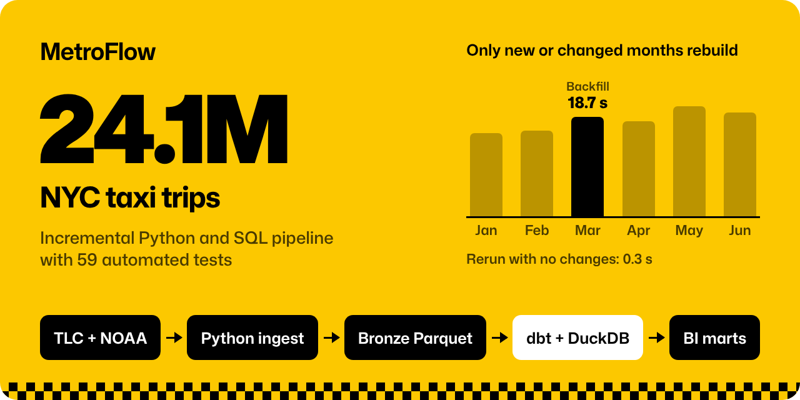
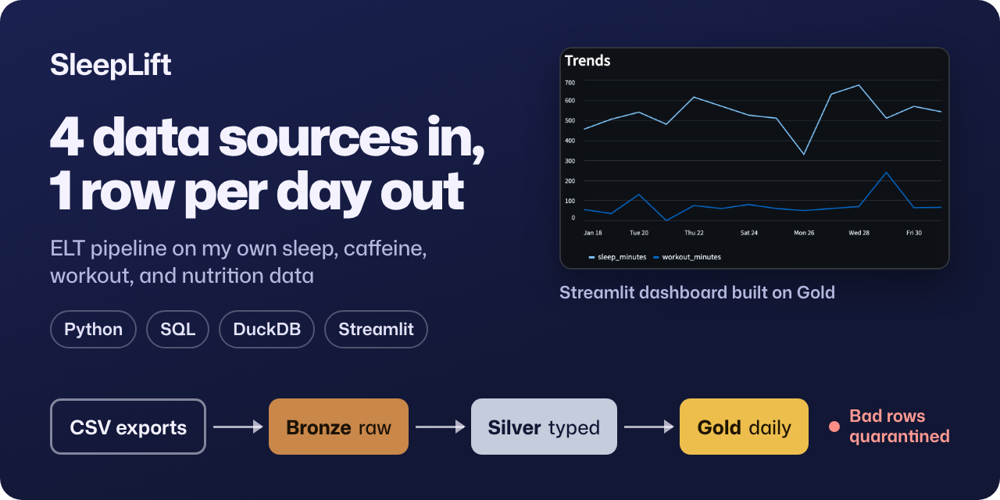

## Hi, I'm Jeffrey

I study Industrial Engineering at Georgia Tech (Analytics & Data Science, May 2028) and I'm focused on data engineering. I'm looking for a 2027 Data Engineering internship, open to any term.

Most of what I build is batch data pipelines in Python and SQL, with a lot of attention on the parts that make data trustworthy: incremental loads, idempotent ingestion, dimensional models, and automated tests.

  
  

### Projects

**[MetroFlow](https://github.com/jeffreylin0217/metroflow)**: incremental pipeline for 24.1M NYC taxi records. It reprocesses only new or changed months using SHA-256 checksums, builds 10 dbt models in DuckDB, and is validated with 38 dbt tests, 21 pytest tests, and GitHub Actions CI.

**[SleepLift](https://github.com/jeffreylin0217/sleeplift)**: Bronze/Silver/Gold ELT pipeline I built for my own sleep, caffeine, workout, and nutrition logs, with idempotent ingestion, a quarantine table for bad rows, and a Streamlit dashboard.

**I2CE VIP research (private repo)**: Undergraduate Researcher, Backend & Data Engineering, on Georgia Tech's I2CE VIP team, building a versioned research file platform and PostgreSQL metadata pipeline shared by 7 project clusters.

### Tools

Python · SQL · dbt · DuckDB · PostgreSQL · Supabase · Parquet · pytest · GitHub Actions · Power BI

### Contact

[LinkedIn](https://www.linkedin.com/in/jeffreylin0217) · lin.jeffrey17@gmail.com
