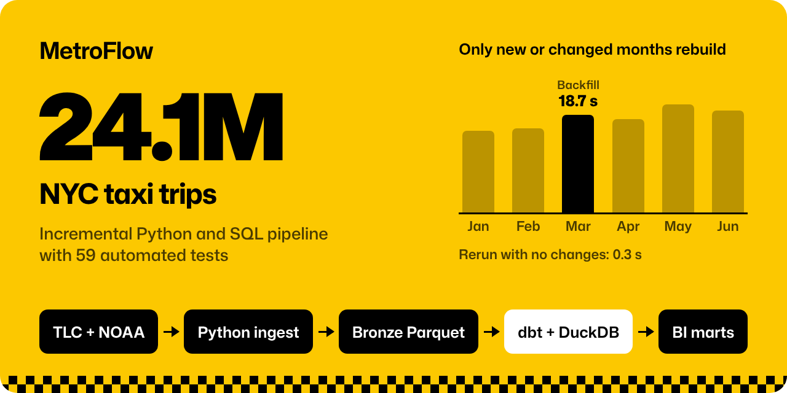
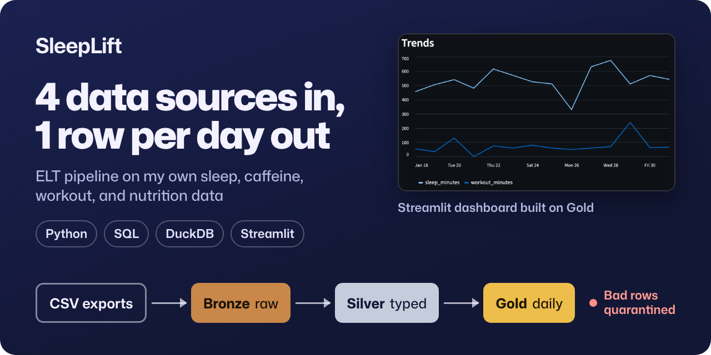

## Hi, I'm Jeffrey

I study Industrial Engineering at Georgia Tech (Analytics & Data Science). I mostly build data pipelines, and lately some AI on top of them, and I spend most of my time checking that the numbers come out right.

  
  

### Projects

**[MetroFlow](https://github.com/jeffreylin0217/metroflow)**: a pipeline for 24.1M NYC taxi trips in Python, DuckDB and dbt. It only reruns the months that changed, and its tests check that the totals tie back to the source. On top is a SQL agent on a local model that can only run read only queries against the final tables. I compared three models on it, including IBM's Granite, and built a separate LangGraph workflow that checks answers about daily totals and asks me when it isn't sure.

**[SleepLift](https://github.com/jeffreylin0217/sleeplift)**: the project that got me into this. A pipeline for my own sleep, caffeine, workout and food logs that rolls everything up to one row per day, sets bad rows aside instead of dropping them, and feeds a small Streamlit dashboard.

**I2CE research team (private repo)**: on a Georgia Tech VIP research team, I built the upload and access layer of a versioned file platform for 7 project clusters. Uploaded files are processed in the background, so a failed parse never breaks the upload. Built with TypeScript, Next.js and Supabase.

### Tools

Python · SQL · TypeScript · PostgreSQL · Supabase · dbt · DuckDB · Parquet · LangGraph · MCP · Ollama · pytest · GitHub Actions

### Contact

[LinkedIn](https://www.linkedin.com/in/jeffreylin0217) · lin.jeffrey17@gmail.com
